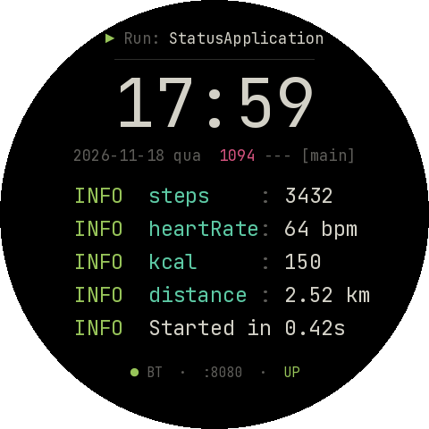

# Spring Log — mostrador para Amazfit T-Rex 3
[🇺🇸 Read in English](#spring-log--watch-face-for-amazfit-t-rex-3)

Mostrador estilo console de log do Spring Boot (Zepp OS, 480x480): hora, data, passos, batimentos, kcal e distância.



Tem `appId` próprio, então pode ficar instalado junto com o status.json e o Builder.class.

## Estrutura

```
spring-face/
├── app.json                         # manifesto (appType: watchface, permissões dos sensores)
├── watchface/index.js               # layout + sensores
└── assets/default.r/
    ├── icon.png                     # preview 324x324 (lista de mostradores)
    └── fonts/JetBrainsMono-Subset.ttf
```

## Instalar no relógio

1. Node.js 18+ e o Zeus CLI:
   ```bash
   npm i -g @zeppos/zeus-cli
   zeus login
   ```
2. No app Zepp no celular: **Perfil → Configurações → Sobre**, toque 7 vezes no logo do Zepp para liberar o **Modo desenvolvedor**.
3. Na pasta do projeto:
   ```bash
   cd spring-face
   zeus preview
   ```
   Escolha o **Amazfit T-Rex 3** quando pedir o dispositivo. Vai aparecer um QR code.
4. No app Zepp: **Perfil → Modo desenvolvedor → Scan**, e escaneie o QR code. O mostrador é instalado e aplicado.

Para testar no simulador antes: `zeus dev` (precisa do Zepp OS Simulator instalado).

## Se o `zeus preview` reclamar do app.json ou dos assets

O formato do `app.json` (v3) e o nome da pasta de assets variam entre versões do Zeus. O jeito mais seguro:

```bash
zeus create teste-wf      # escolha: Watchface → T-Rex 3
```

Compare o `app.json` e a pasta `assets/` gerados com os deste projeto. Copie de lá o bloco `targets` e o nome da pasta de assets, mantenha as `permissions` deste projeto e mova `icon.png` + `fonts/` para a pasta que o template criou. O `appId` gerado pelo template também pode ser usado no lugar do daqui.

## Personalizar

Tudo fica no topo de `watchface/index.js`:

- **Cores:** objeto `C` (hex `0xRRGGBB`)
- **Log:** `LOG_X`, `LOG_TOP`, `LOG_SIZE`, `LOG_H`
- **PID** exibido no cabeçalho: `PID`
- **Dias da semana:** array `DAYS`

## Comportamento

- Batimento sem medição recente: a linha vira `WARN heartRate: null` (amarelo).
- Ao bater a meta de passos do relógio, a última linha vira `Goal reached: <meta>`.
- Barra de status: `● ... UP` verde com o celular conectado por Bluetooth, `DOWN` vermelho desconectado (atualiza a cada minuto e ao acender a tela).
- Distância vem em metros do sensor e é exibida em km com 2 casas.
- Não tem versão AOD (tela sempre ligada) ainda.

Fonte: JetBrains Mono (SIL OFL 1.1), reduzida aos caracteres usados (inclui ▶ e ●).

---

# Spring Log — watch face for Amazfit T-Rex 3
[🇧🇷 Leia em Português](#spring-log--mostrador-para-amazfit-t-rex-3)

Spring Boot log console style watch face (Zepp OS, 480x480): time, date, steps, heart rate, calories and distance.


It has its own `appId`, so it can be installed alongside status.json and Builder.class.

## Structure

```
spring-face/
├── app.json                         # manifest (appType: watchface, sensor permissions)
├── watchface/index.js               # layout + sensors
└── assets/default.r/
    ├── icon.png                     # 324x324 preview (watch face list)
    └── fonts/JetBrainsMono-Subset.ttf
```

## Install on the watch

1. Node.js 18+ and the Zeus CLI:
   ```bash
   npm i -g @zeppos/zeus-cli
   zeus login
   ```
2. In the Zepp app on your phone: **Profile → Settings → About**, tap the Zepp logo 7 times to enable **Developer mode**.
3. In the project folder:
   ```bash
   cd spring-face
   zeus preview
   ```
   Pick **Amazfit T-Rex 3** when asked for the device. A QR code will show up.
4. In the Zepp app: **Profile → Developer mode → Scan**, and scan the QR code. The watch face is installed and applied.

To try it in the simulator first: `zeus dev` (requires the Zepp OS Simulator).

## If `zeus preview` complains about app.json or the assets

The `app.json` format (v3) and the assets folder name change between Zeus versions. The safest fix:

```bash
zeus create test-wf      # choose: Watchface → T-Rex 3
```

Compare the generated `app.json` and `assets/` folder with the ones in this project. Copy the `targets` block and the assets folder name from there, keep this project's `permissions`, and move `icon.png` + `fonts/` into the folder the template created.

## Customize

Everything is at the top of `watchface/index.js`:

- **Colors:** the `C` object (hex `0xRRGGBB`)
- **Log:** `LOG_X`, `LOG_TOP`, `LOG_SIZE`, `LOG_H`
- **PID** shown in the header: `PID`
- **Weekdays:** the `DAYS` array

## Behavior

- Heart rate with no recent reading: the line becomes `WARN heartRate: null` (yellow).
- When the watch step goal is reached, the last line becomes `Goal reached: <goal>`.
- Status bar: green `● ... UP` while the phone is connected over Bluetooth, red `DOWN` when disconnected (updates every minute and when the screen wakes up).
- Distance comes from the sensor in meters and is shown in km with 2 decimals.
- No AOD (always-on display) version yet.

Font: JetBrains Mono (SIL OFL 1.1), subset to the characters used (includes ▶ and ●).
